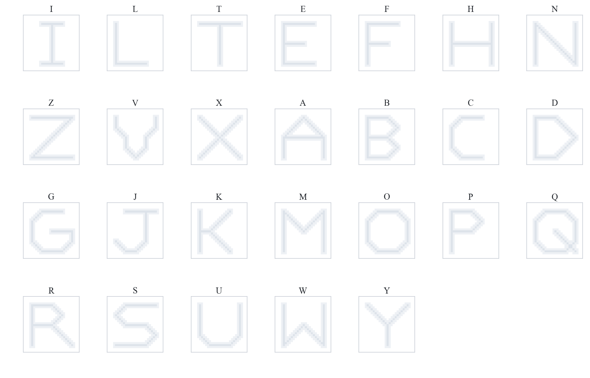
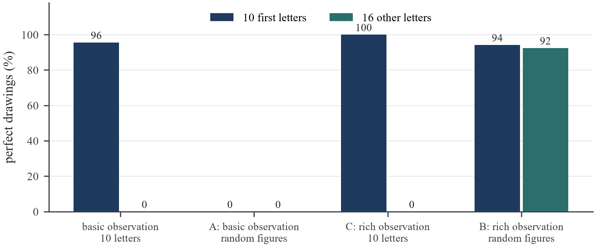
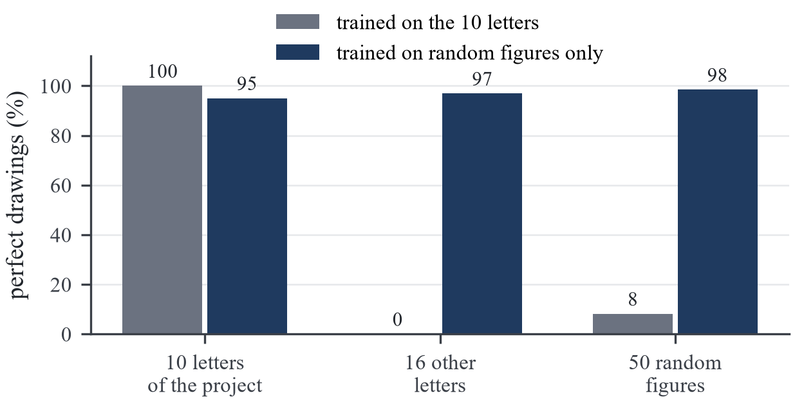

# Letter-Writing Agent

**An agent that learns to draw letters by trial and error, from tabular reinforcement learning to a convolutional
DQN that draws letters it has never seen.**

[](https://www.python.org/)
[](https://pytorch.org/)
[](https://numpy.org/)
[](https://matplotlib.org/)
[](https://jupyter.org/)


<p align="center">
  
</p>
<p align="center"><em>Trained only on random figures, the agent draws the 26 letters of the alphabet, none of which it
saw during training (63 of 66 episodes perfect).</em></p>

## Highlights

- **Letter drawing as a Markov decision process**: a pen on a 5×5 grid, 17 actions, rewards for correct strokes;
  the exact optimum is computed with **value iteration** and used as a benchmark.
- **Tabular methods compared with the optimum**: Q-learning reaches 93–100 % of the optimal return; SARSA is as
  good but 1.5× slower; Monte Carlo falls into a *"giving up" trap* (it learns to stop early), which we explain and
  partly fix through reward design.
- **Reward design shapes behaviour**: a penalty for going back over a stroke produces human-like writing; removing
  intermediate rewards slows Q-learning 2–3×.
- **Generalisation**: a DQN trained on 10 letters draws **0 %** of unseen letters; with diverse training targets and
  a richer observation it reaches **92 %**.
- **Free drawing on pixels**: on a 28×28 canvas (81 actions), a **convolutional Double DQN** with a pen-centred view,
  trained only on random figures, draws **96 %** of the 26 letters perfectly.

## Results

| Experiment | Result |
|---|---|
| Value iteration (exact optimum) | every letter drawn perfectly; convergence in 13–23 iterations |
| Q-learning · SARSA · Monte Carlo (10 letters, 5 seeds) | 93–100 % · 84–100 % of the optimum · fails ("giving up" trap) |
| DQN on the 10 letters | 87–100 % of the optimum, ~1,200 episodes per letter (vs 5,000–12,500 for Q-learning) |
| DQN on the 16 unseen letters | 0 % → **92 %** with random training figures + rich observation |
| Blank sheet, trained on the 10 letters | 100 % on them, 0 % on the 16 others |
| Blank sheet, trained on random figures only | **96 %** of the 26 letters, all unseen |

<p align="center">
  
  
</p>
<p align="center"><em>Left: on the grid, only random figures + a rich observation generalise. Right: on the pixel
canvas, the generalist trained on random figures beats the specialist on every unseen target.</em></p>

## How it works

**1. The grid.** The state is the pen position (25 cells), pen up or down, and the segments already drawn (a bit
mask: up to 204,800 states per letter). Actions: 8 directions × pen up/down + STOP. Rewards: +1 per new segment,
−1 outside the letter, −0.05 per move, −0.3 per new stroke, +2 for stopping on a complete letter.
Algorithms: value iteration, Q-learning, SARSA, first-visit Monte Carlo, and a DQN (experience replay, target
network, Huber loss).

**2. The blank sheet.** A 28×28 canvas; moves of 1, 2 or 5 pixels in 16 directions, pen up or down, + STOP
(81 actions); the target is an image of the letter, judged with a 1-pixel tolerance. A convolutional Double DQN
sees a 41×41 window centred on the pen (strokes still missing, ink, canvas, pen state). It is trained on random
stroke figures, the network is selected on 50 held-out figures, and the letters are used only for the final test.

## Repository structure

```
src/          environments, algorithms (DP, tabular, DQN), random figures, plotting style
notebooks/    01–13: one notebook per experiment, with outputs
results/      trained networks (.pt), learning curves, tables, animations
figures/      the 17 figures of the report
docs/         full project dossier: MDP choices, results of every step, algorithm comparison, references
```

## Quickstart

```bash
git clone https://github.com/VeneraSinanaj/letter-writing-agent.git
cd letter-writing-agent
python -m venv .venv
.venv\Scripts\activate          # Windows; on macOS / Linux: source .venv/bin/activate
pip install -r requirements.txt
jupyter notebook notebooks/
```

| Notebooks | Content |
|---|---|
| `01`–`06` | the grid environment, value iteration, Q-learning, SARSA, Monte Carlo, reward experiments |
| `07`–`09` | DQN on the 10 letters, test on unseen letters, better generalisation |
| `10` | the report figures |
| `11`–`13` | the blank sheet: environment, convolutional DQN, generalisation |

The trained networks are included, so each notebook runs in under 15 minutes on a laptop CPU; set `RETRAIN = True`
in a notebook to train again (up to ~9 hours for the longest run).

## Learn more

The [project dossier](docs/PROJECT_DOSSIER.md) gives every modelling choice, the detailed results of each step, a
comparison of the algorithms (advantages, limits, evidence) and the references.

## Context

Group project of three students for the Reinforcement Learning course of N. Mayer (Master DS2E, University of
Strasbourg, 2026–27). Inspired by RL agents that draw, such as SPIRAL (Ganin et al., 2018) and Learning to Paint
(Huang et al., 2019). Main references: Sutton & Barto (2018), *Reinforcement Learning: An Introduction*;
Mnih et al. (2015), DQN; van Hasselt et al. (2016), Double DQN.
